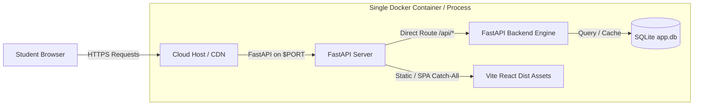

# OP FFCS / Resumio — Online Deployment Guide

This guide explains how to deploy **OP FFCS** to the web so anyone can access it online from a public URL.

The application is fully containerized and unified: FastAPI serves both the high-performance backend API and the compiled React 19 production frontend from a single web service.

---

## Architecture Overview



---

## Option 1: Deploy on Render.com (Recommended — Free & Easiest)

[Render](https://render.com) offers free web service hosting and natively supports our `render.yaml` and `Dockerfile`.

### Steps:
1. **Push your repository to GitHub**:
   ```bash
   git add .
   git commit -m "feat: add Dockerfile and deployment manifests"
   git push origin master
   ```
2. **Log into [dashboard.render.com](https://dashboard.render.com/)**.
3. Click **New +** &rarr; **Web Service**.
4. Connect your GitHub repository.
5. Configure the service:
   * **Name**: `op-ffcs`
   * **Language / Environment**: `Docker`
   * **Branch**: `master` (or `main`)
   * **Plan**: `Free`
6. Under **Advanced / Environment Variables**, verify:
   * `PORT`: `10000` (Render automatically routes traffic to this port)
   * `RESUMIO_HOST`: `0.0.0.0`
   * `ALLOWED_ORIGINS`: `*`
7. Click **Create Web Service**.
8. Render will build the Docker container (compiling React and installing Python dependencies) and provide a live public HTTPS URL (e.g., `https://op-ffcs.onrender.com`).

---

## Option 2: Deploy on Railway.app

[Railway](https://railway.app) automatically detects Dockerfiles and deploys in under 2 minutes.

### Steps:
1. Push your repository to GitHub.
2. Go to [railway.app](https://railway.app) and click **New Project** &rarr; **Deploy from GitHub repo**.
3. Select this repository.
4. Railway will automatically pick up the [Dockerfile](file:///D:/ffcs-maker/Dockerfile), inject the `$PORT` variable, and start the app.
5. In project settings, click **Generate Domain** to get a public URL (e.g. `https://op-ffcs.up.railway.app`).

---

## Option 3: Deploy on Google Cloud Run (Serverless Container)

For high performance, auto-scaling, and global distribution:

### Steps:
1. Ensure the Google Cloud SDK (`gcloud`) is installed and authenticated:
   ```bash
   gcloud auth login
   gcloud config set project YOUR_PROJECT_ID
   ```
2. Build and deploy directly to Cloud Run:
   ```bash
   gcloud run deploy op-ffcs \
     --source . \
     --region us-central1 \
     --allow-unauthenticated \
     --port 8000 \
     --memory 1Gi
   ```
3. Cloud Run will output your live URL (e.g., `https://op-ffcs-xxxx-uc.a.run.app`).

---

## Option 4: Deploy on Linux VPS (Ubuntu / Debian / DigitalOcean)

If you have a Linux virtual machine:

### With Docker Compose:
1. Clone the repository onto your server:
   ```bash
   git clone <your-repo-url>
   cd ffcs-maker
   ```
2. Start the container in the background:
   ```bash
   docker compose up -d --build
   ```
3. The app is live at `http://YOUR_SERVER_IP:8000`.

### Without Docker (Direct Native Run):
1. Install Node 20 and Python 3.11:
   ```bash
   sudo apt update && sudo apt install -y python3 python3-pip python3-venv nodejs npm
   ```
2. Build frontend:
   ```bash
   cd frontend && npm install && npm run build && cd ..
   ```
3. Install backend dependencies:
   ```bash
   pip3 install -r requirements.txt
   ```
4. Run with systemd or tmux:
   ```bash
   python3 -m uvicorn backend.app:app --host 0.0.0.0 --port 8000
   ```

---

## Health Check & Verification

Once deployed, you can verify your service status at:
* **Interactive Frontend**: `https://<your-deployed-domain>/`
* **API Documentation**: `https://<your-deployed-domain>/docs`
* **Health Check**: `https://<your-deployed-domain>/api/health`
