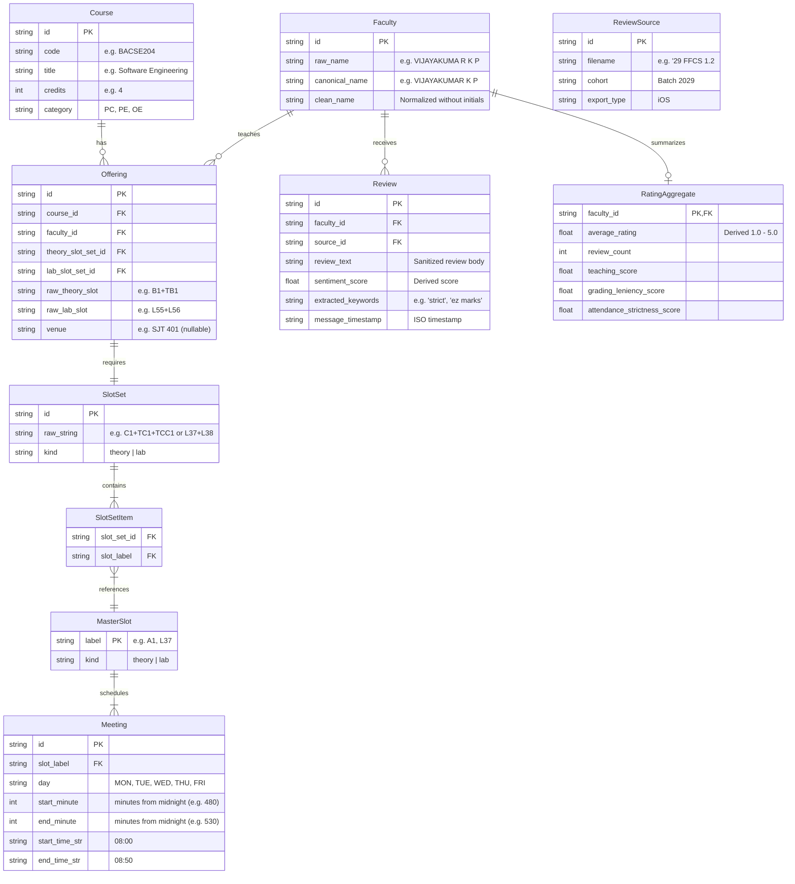

# System Architecture & Normalized Data Model

**Architectural Specification for Personal, Local-First FFCS Timetable Maker**

---

## 1. Normalized Relational Data Model

Based strictly on the verified structures from `subject_teachers_slots_reviews_corrected_v2.xlsx`, the WhatsApp chat exports, and the VIT slot grid, the system requires the following normalized relational entities:

### Exploding Bundled Slots & Combined Lab Sessions

#### 1. Theory Slot Bundles (e.g., `C1+TC1+TCC1`)
- Split by `+` into atomic slot labels: `['C1', 'TC1', 'TCC1']`.
- Lookup each atomic label in `MasterSlot` -> `Meeting`:
  - `C1` -> Meeting 1: `(WED, 08:00–08:50)`, Meeting 2: `(FRI, 09:00–09:50)`
  - `TC1` -> Meeting 3: `(TUE, 11:00–11:50)`
  - `TCC1` -> Meeting 4: `(THU, 12:00–12:50)`
- Total physical meetings generated for this single offering: **4 meetings across 4 distinct days**.

#### 2. Lab Slot Bundles (e.g., `L37+L38`)
- In VIT FFCS, a lab course requires 2 consecutive periods.
- In the grid:
  - `L37` = Tuesday 14:00–14:50
  - `L38` = Tuesday 14:51–15:40
- **Consolidation**: Instead of treating these as two fragmented blocks, the ingestion engine identifies contiguous lab slots on the same day ($T_{\text{start2}} = T_{\text{end1}} + 1\text{ min}$) and fuses them into **ONE continuous lab session**:
  - `Day`: `TUE`
  - `Start`: `14:00` (840 minutes)
  - `End`: `15:40` (940 minutes)
  - `Duration`: `100 minutes`

---

## 2. Technology Stack Evaluation & Selection

### Comparison of Candidate Stacks

| Criterion | Option A: Python (FastAPI) + SQLite + React 19 (Vite) | Option B: Pure TypeScript (Express / Next.js + SQLite) |
| :--- | :--- | :--- |
| **Windows Tooling Compatibility** | **Zero Friction**: Python 3.11.9 & SQLite3 module already installed. No C++ compiler needed. | **Medium-High Friction**: `better-sqlite3` on Windows often requires node-gyp and MSBuild tools. |
| **Excel & Data Processing** | **Native**: Standard library + Python regex and NLP tools (`difflib`, `spacy`/`nltk` if needed). | Requires JS packages (`xlsx`, `exceljs`, `natural`). |
| **Local-First & Offline** | **100% Offline**: Single SQLite file (`ffcs.db`) stored on disk; zero cloud services. | 100% Offline with local SQLite. |
| **Combinatorial Generation** | **Blazing Fast**: Python with bitwise 64-bit integer masks or Web Worker in browser. | Web Worker offloading in TypeScript. |
| **Developer Ergonomics** | Clean decoupled API; frontend and backend can be tested independently. | Unified language across client and server. |

### Final Stack Selection: Option A (Decoupled Local Architecture)
- **Frontend**: React 19 + TypeScript + Vite + Tailwind CSS v4 + Lucide Icons.
- **Backend API**: Python 3.11 with FastAPI + Uvicorn (local HTTP on port 8000).
- **Local Persistence**: Embedded SQLite (`ffcs.db`) via Python's built-in `sqlite3` (v3.45.1).
- **Search & Clash Engine**:
  - Generator runs in the **Python Backend** utilizing a Depth-First Search with Minimum Remaining Values (MRV) heuristic and bitwise day-clash masks.
  - A secondary browser-side Web Worker generator in TypeScript can be provided for instant interactive filtering and slider tweaking without network round-trips.

---

## 3. Key Technical Risks & Mitigations

1. **Faculty Name Discrepancies**:
   - *Risk*: `VIJAYAKUMA R K P` vs `Dr. Vijayakumar K.P.` in chats vs `Vijayakumar` in rating sites.
   - *Mitigation*: Multi-stage canonicalizer: (1) Regex space collapse; (2) Title stripping (`Dr.`, `Prof.`, `Sir`); (3) Token sort matching (`difflib.SequenceMatcher` / Levenshtein distance $\ge 0.88$).
2. **Student PII in WhatsApp Exports**:
   - *Risk*: Chat exports contain real telephone numbers and student names.
   - *Mitigation*: Hard sanitization pipeline before database insertion. Telephones redacted via regex; senders hashed to synthetic identifiers; original chat text scrubbed.
3. **Combinatorial Explosion in Timetable Generation**:
   - *Risk*: Enrolling in 9 courses with an average of 8 faculty options yields $8^9 \approx 134,217,728$ potential timetable combinations.
   - *Mitigation*: Backtracking search with branch-and-bound pruning. Courses with the fewest conflict-free options are scheduled first (MRV). Time intervals represented as 64-bit integers with bitwise AND clash checks ($O(1)$ clash detection per candidate).
4. **Third-Party Data Licensing**:
   - *Risk*: Scraped web ratings have unclear copyrights.
   - *Mitigation*: System runs 100% locally with user's provided files. External ratings are kept as optional user-supplied imports, never hard-coded or redistributed.

---

## 4. 12-Step Implementation Plan

1. **Step 1: Excel Ingestion Engine**: Parse canonical offerings from `subject_teachers_slots_reviews_corrected_v2.xlsx`, clean space-wrapped faculty names, and persist Courses, Faculty, and Offerings into SQLite.
2. **Step 2: Slot & Meeting Engine**: Ingest the 101-slot VIT default grid, map atomic tokens, explode bundles, fuse contiguous lab slots into 100-min blocks, and implement interval-based clash detection.
3. **Step 3: WhatsApp Chat Parsing**: Parse iOS WhatsApp exports, handle multi-line continuations, scrub PII (telephones/names), and extract candidate review messages.
4. **Step 4: Faculty Entity Resolution & Sentiment Aggregator**: Match chat reviews to canonical faculty IDs using fuzzy string matching, compute rating distributions, and generate structured aggregates.
5. **Step 5: Local API Scaffolding (FastAPI + SQLite)**: Create parameterized REST endpoints for courses, faculty, offerings, reviews, and search options.
6. **Step 6: High-Performance Combinatorial Generator**: Implement DFS + MRV backtracking engine with bitmask pruning and ranking profiles (`Balanced`, `Half Days`, `Early Finish`, `Low Gaps`, `Top Rated`).
7. **Step 7: Frontend Timetable Matrix UI**: Build the VIT-authentic dual-row (Theory/Lab) slot matrix grid with time markers and lunch divider.
8. **Step 8: Course Selection & Constraint Controls**: Interactive UI for picking target courses, locking preferred professors, blocking custom time windows, and setting ranking weights.
9. **Step 9: Timetable Comparison & Inspector**: Side-by-side timetable comparator highlighting differences in breaks, faculty ratings, and class distributions.
10. **Step 10: State Persistence & Re-import**: Local storage saving of generated schedules, custom notes, and ability to re-import updated Excel/chat files without data loss.
11. **Step 11: Export Suite**: Generate high-resolution schedule images (PNG), printable PDF timetables, and standard iCalendar (`.ics`) files for Google Calendar / Apple Calendar.
12. **Step 12: Comprehensive Test Suite & QA**: End-to-end integration tests, unit tests for clash detection edge cases, WCAG 2.2 AA accessibility audit, and theme verification (Light/Dark).
